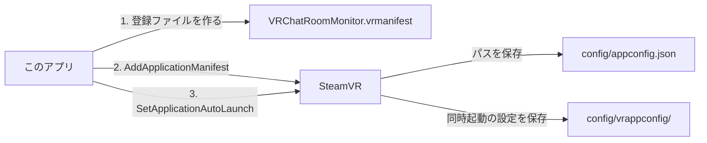

# VRChat Room Monitor

[](https://github.com/ryoctrl/VRChatRoomMonitor/actions/workflows/ci.yml)

VRChat のログファイルを監視して、今いるルームの状況と入退室の記録をデスクトップに表示する Windows 用のアプリです。
VR ゴーグルを外してデスクトップで作業している間に誰かが入ってきても、画面右下のポップアップと通知音で気づけます。

VRChat Inc. の公式ツールではなく、同社とは関係ありません。

## ダウンロード

[Releases](https://github.com/ryoctrl/VRChatRoomMonitor/releases/latest) から選んでください。

| ファイル | 内容 |
|---|---|
| `VRChatRoomMonitor-<版>-setup.exe` | インストーラ（おすすめ）。アプリの中から更新でき、WebView2 ランタイムが無い PC では自動で導入する |
| `VRChatRoomMonitor.exe` | そのまま実行できる exe。更新は配布ページから手動で行う |
| `VRChatRoomMonitor-<版>-windows-x64.zip` | exe、説明書、ライセンス文書 |

電子署名の無いアプリのため、初回は「Windows によって PC が保護されました」と表示されることがあります。その場合は「詳細情報」→「実行」を押してください。

## できること

- 現在のワールド名、インスタンスの種類（Public / Friends+ / Invite など）、リージョン、入室からの経過時間
- ルーム内の人数と一覧（後から来た人は 2 分間緑色で表示、入室前からいた人は「先客」）
- 入退室・ワールド移動・招待／招待リクエスト・グループ通知の記録（新しいものが上。長い本文はマウスを乗せると全文を表示）
- 配信に映すときなどに、記録の表示を現在のワールドの分だけに絞る切り替え（「現在のワールドのみ」。招待やグループ通知も隠します。ポップアップは別の設定で、この切り替えでは変わりません）
- 後から誰かが入ってきたときや招待、グループ通知が届いたときの、画面右下のポップアップ、通知音、タスクバーの点滅
- 通知音は入室、退室、招待などごとに、オリジナルの 5 種類、Windows 標準、なしから選択（選ぶとその場で鳴る）
- ウィンドウの題名を「VRChat Room Monitor」に固定する切り替え（「タイトルを固定」。配信ソフトのウィンドウキャプチャで題名を一致させたいときに）
- ウィンドウを閉じてもトレイで監視を継続
- 新しい版の確認と、アプリの中からの更新
- SteamVR との同時起動（任意）

## 動作環境

- Windows 10 / 11（64bit）と WebView2 ランタイム（Windows 11 は標準搭載）
- PC 版 VRChat（Steam 版、Meta Quest Link や Steam Link で PC につないで遊ぶ場合も含む）

Quest 単体（PC を使わない遊び方）では PC にログが出ないため使えません。

## 仕組みと制限

- VRChat が出力する `%USERPROFILE%\AppData\LocalLow\VRChat\VRChat\output_log_*.txt` を読むだけで、VRChat 本体には手を加えません。
- インターネット通信は、下記の更新の確認とダウンロードだけです。画面下の「更新を確認」をオフにすると通信しません。
- ログにはフレンド情報が含まれないため、フレンドかどうかやオンライン中のフレンド数は表示できません。
- 入室時点でいた人と後から来た人の区別は、ログ中の自分の初期化記録（`Initialized PlayerAPI "…" is local`）の前後で判定しています。

### 履歴の保持

入退室の履歴はメモリ上にだけ持ち、アプリ独自の履歴ファイルやキャッシュは作りません。

- 起動時に、VRChat の最新のログファイル 1 つを読み直して履歴を作ります。それより前のログは読みません。
- 起動中は新しい記録を追加し、VRChat を再起動しても履歴を引き継ぎます。上限は 500 件で、超えると古いものから消えます。
- アプリを終了すると履歴は消え、次の起動時に最新のログファイルから作り直します。
- ディスクに保存するのは設定だけです（`%APPDATA%\com.ryoctrl.vrchatroommonitor`）。

### アプリの更新

[Tauri の updater](https://tauri.app/plugin/updater/) を使っています。

- 起動の 15 秒後と、その後 6 時間ごとに、最新のリリースの `latest.json` を GitHub から取得して版を比べます。
- 新しい版があると、画面上部とポップアップで知らせます。VR の最中に再起動しないよう、更新は「更新して再起動」を押したときに行います。
- インストーラは、公開鍵（`src-tauri/tauri.conf.json`）で署名を検証してから実行します。
- exe 版（インストーラを使っていない場合）は、更新するとインストール先が変わってしまうので、配布ページを案内します。

### SteamVR との連携

SteamVR の設定画面の「起動時のオーバーレイアプリ」の一覧には、次の流れで載ります。



- SteamVR の起動中にこのアプリを起動すると、1 と 2 を自動で行います。同時起動はオフのままです。
- 同時起動（3）は、このアプリのチェックと SteamVR の設定画面のどちらからでも切り替えられ、互いに反映されます。
- 一覧から外すときは「SteamVR の一覧から削除」を押します。以後は自動で追加しません。
- SteamVR の「アドオン」はドライバの一覧なので、このアプリは載りません。

## 開発

| 分野 | 技術 |
|---|---|
| アプリ | [Tauri v2](https://tauri.app/)（Rust） |
| 画面 | TypeScript、Vite（フレームワークなし） |
| 検査 | cargo fmt、Clippy、Biome、tsc |
| テスト | cargo test、Vitest、ビルドした exe の動作確認（`crates/smoke-test`） |

```text
crates/
  monitor-core/   ログの解析、ルーム状態、ログファイルの監視、設定（GUI に依存しない）
  steamvr/        OpenVR の呼び出し、登録ファイル、SteamVR の起動と終了の追従
  smoke-test/     ビルドした exe を起動して確認するプログラム
src-tauri/        アプリ本体（ウィンドウ、トレイ、通知、コマンド）
src/              画面
packaging/        配布用の説明書、ライセンス一覧のテンプレート
scripts/          ライセンス一覧の生成、配布ファイルの作成
assets/           アイコンの元データ
```

必要なもの: [Rust](https://rustup.rs/)、Node.js 24、pnpm、[Tauri の前提条件](https://tauri.app/start/prerequisites/)

```bash
pnpm install
```

```bash
pnpm tauri dev
```

検査とテスト:

```bash
pnpm lint && pnpm typecheck && pnpm test
```

```bash
cargo fmt --all --check && cargo clippy --workspace --all-targets -- -D warnings
```

```bash
cargo test --workspace --exclude vrchat-room-monitor
```

ビルドと動作確認:

```bash
pnpm tauri build
```

```bash
cargo run -p smoke-test -- target/release/VRChatRoomMonitor.exe
```

通知音は音源ファイルを持たず、`crates/monitor-core/src/sound.rs` の音符から合成しています。次のコマンドで `target/sounds` に WAV ファイルとして書き出して聞けます。

```bash
cargo test -p monitor-core writes_sounds -- --ignored
```

SteamVR との連携は、SteamVR を起動した状態で次のコマンドでも確認できます。

```bash
cargo test -p steamvr -- --ignored --nocapture
```

## リリース手順

1. `src-tauri/Cargo.toml` の `version` と `CHANGELOG.md` を書き換えて、`main` に入れる
2. 同じ版のタグを push する

```bash
git tag v0.3.0
```

```bash
git push origin v0.3.0
```

タグを push すると [Release ワークフロー](.github/workflows/release.yml) が、タグと版の一致を確認し、CI と同じ検査、テスト、ビルド、exe の動作確認を行ったうえで、インストーラに署名し、更新情報の `latest.json` と一緒に GitHub Release として公開します。

署名の秘密鍵は、リポジトリの Secret `TAURI_SIGNING_PRIVATE_KEY` に登録します。鍵を失うと既存の利用者へ更新を届けられなくなるので、控えを安全な場所に保管してください。

## ライセンス

[MIT License](LICENSE)。exe に含まれるライブラリのライセンスは、アプリの「ライセンス」と zip 内の `THIRD-PARTY-NOTICES.html` で確認できます。
